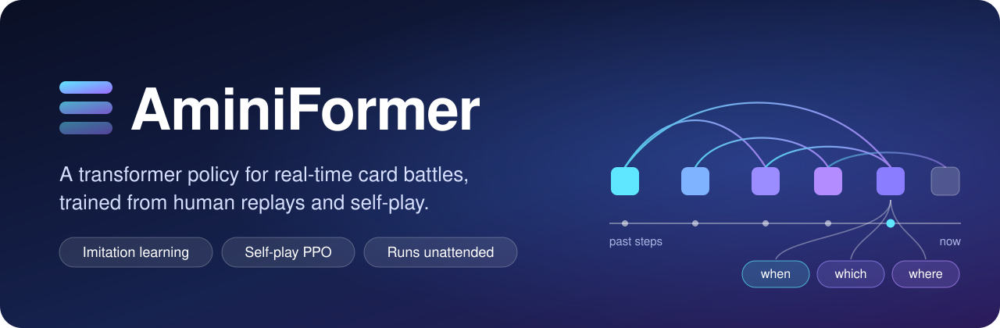
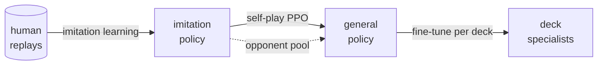
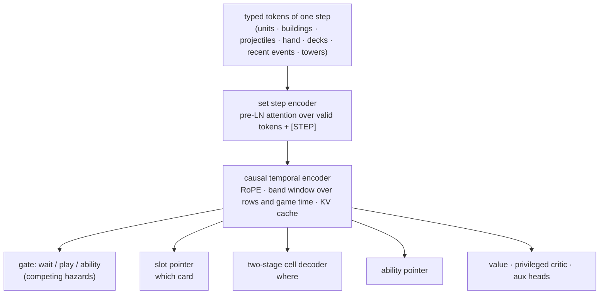

<p align="center">
  
</p>

<p align="center">
  <a href="#highlights">Highlights</a> ·
  <a href="#how-it-works">How it works</a> ·
  <a href="#results">Results</a> ·
  <a href="#repository-layout">Layout</a> ·
  <a href="#getting-started">Getting started</a> ·
  <a href="README.zh-CN.md">中文</a>
</p>

<p align="center">
  
  
  
  
</p>

**AminiFormer** is the policy network and training machinery behind my AI for *Clash Royale*. It learns the game from human replays, then keeps improving through self-play PPO. The whole system was trained on **one RTX 4090 and a few rented cloud GPUs**.

This repository is the **public edition**: the real code of the model, the imitation-learning trainer, the PPO learner and the tooling that lets a run train unattended for days, copied from the private project and cleaned. The game environment, the data pipeline, the trained weights and the tuned settings stay private, so the defaults here are example values.

## Highlights

- **A policy that reads the whole board.** Every unit, building, projectile, card and recent event is a typed token. A set encoder summarises each decision step; a causal temporal encoder with rotary positions attends over recent steps, windowed by both rows and game time.
- **Decides *when*, not just *what*.** The gate is a competing-hazard model over three families (wait, play, ability), so timing is part of the action rather than a fixed polling interval. A pointer picks the card, a two-stage cell decoder picks the spot, and a second pointer targets abilities.
- **Streams in real time.** `peek` / `commit` advance the temporal encoder one step at a time with a key/value cache, matching the full-sequence training pass.
- **Asymmetric critic.** Hidden information reaches only the privileged critic and the auxiliary losses, never a policy logit.
- **Imitation, then self-play.** A multi-head imitation trainer (EMA weights, burn-in, gate-bias fitting) feeds a PPO learner with a frozen reference policy, a separate critic, dual-clip PPO, a KL penalty, KL-based early stopping and per-tick GAE with Horvitz-Thompson weights for sampled waits.
- **Learns while it plays.** Rollout lag of one or two updates with truncated importance weights and V-trace style returns, plus explicit rules that fall back to synchronous collection when the policies drift apart.
- **Built to run unattended.** 34 monitor rules turn every failure mode into a logged action: an update-0 identity check between actors and learner, entropy and KL guards, critic checks, drop and memory alarms, rollback to the champion, a stall ladder, and a check that the policy has not drifted away from human play.
- **Careful promotion.** Gates play paired games on common random numbers with seat swaps, use sequential tests and canary opponents, run A/A null checks, and break results down by the opponent's win condition.

## How it works





The PPO loop: actors play batches of games against an opponent pool → the learner runs PPO on the recorded shards → the monitor checks every update → snapshots are gated against the champion, and the policy is checked for drift from human play.

## Results

- **Self-play pays off.** In head-to-head matches in the simulator, the self-play policy is estimated at **+540 to +620 Elo** over the imitation policy it started from.
- **Small hardware.** One RTX 4090 trains the network; a few rented cloud GPUs play the self-play games.

## Repository layout

```
src/amini/
├── nn/
│   ├── aminiformer.py   the policy: token embeddings, step and temporal encoders, all heads, streaming API
│   ├── schema_v1.py     token groups, feature columns, frozen encodings, input rules
│   └── amp_policy.py    device / dtype / attention-backend dispatch
├── train/
│   └── il_v7.py         imitation-learning trainer
└── ppo/
    ├── config.py        the run configuration (22 sections, validation, digest, YAML loading)
    ├── buffer.py        rollout shard format between actors and learner
    ├── learner.py       PPO learner: policy, frozen reference, separate critic
    ├── losses.py · logprob.py · gae.py
    ├── overlap.py · pipeline.py   rollout lag
    ├── monitor.py       the 34 run monitors, rollback and stall ladder
    ├── drift.py         drift from human play
    └── stats.py         gate statistics
tools/ppo_v7/gate.py     gate runner: schedules, stores and decides promotion games
configs/ppo_v7_main.yaml every config field with its example value
tests/v7/                the test suite
```

## Getting started

```bash
git clone https://github.com/Aminiwow/aminiformer.git
cd aminiformer
pip install -e ".[dev]"
pytest -q
```

307 tests run on any machine. Another 324 need the private dataset, environment or tooling and are skipped with a reason.

To train for real you need two things this repository does not ship: a game environment and replay data converted to the token layout in `schema_v1.py`. Code paths that need a private module raise a clear error saying which part is missing.

## What is not included

- the game environment, and any code that connects to, reads or controls the game client;
- replays, the data pipeline and the tokenizer that turns game records into tokens;
- trained weights;
- tuned hyperparameters, the opponent and deck mix, the specialisation recipe, training phase rules, and the client-side action rules.

## Disclaimer

This is an independent, unofficial project. It is not affiliated with, endorsed, sponsored or specifically approved by Supercell, and Supercell is not responsible for it. *Clash Royale* is a trademark of Supercell Oy. This repository contains no game code, assets or data.

## License

No license is granted at this time: all rights reserved. You are welcome to read the code and learn from it. Open an issue if you would like to use it.
