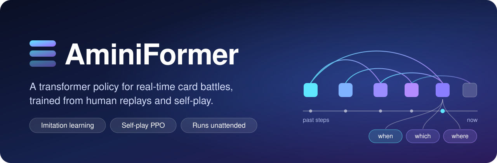
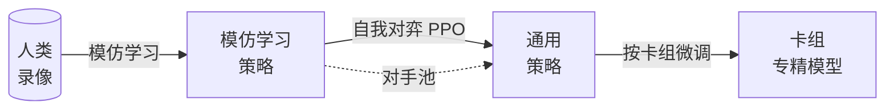
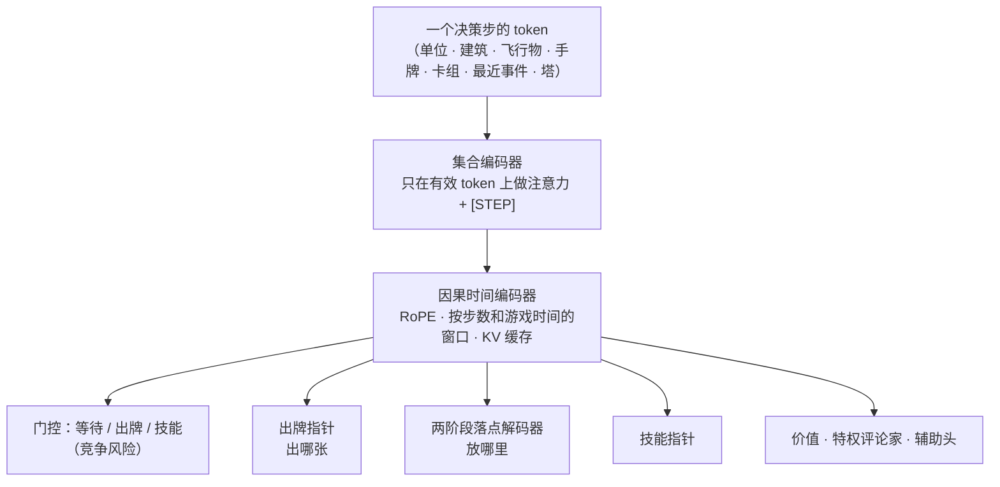

<p align="center">
  
</p>

<p align="center">
  <a href="#亮点">亮点</a> ·
  <a href="#工作原理">工作原理</a> ·
  <a href="#成果">成果</a> ·
  <a href="#目录结构">目录</a> ·
  <a href="#快速开始">快速开始</a> ·
  <a href="README.md">English</a>
</p>

<p align="center">
  
  
  
  
</p>

**AminiFormer** 是我的《皇室战争》（*Clash Royale*）AI 的策略网络和训练框架。它先从人类对局录像中学会打牌，再通过自我对弈 PPO 不断变强。整套系统只用了**一张 RTX 4090 和几台租来的云 GPU**。

这个仓库是**公开版**：模型、模仿学习训练器、PPO 学习器，以及让训练无人值守连跑多天的工具，都是从私有项目里复制过来的真代码，只做了清理。游戏环境、数据流程、训练好的权重和调好的参数仍然保密，所以仓库里的默认值都是示例值。

## 亮点

- **看懂整个棋盘的策略网络。** 每个单位、建筑、飞行物、卡牌和最近的出牌事件都是一个带类型的 token。集合编码器把每个决策步汇总成一个向量；因果时间编码器用旋转位置编码关注最近若干步，窗口同时按步数和游戏时间限定。
- **不只决定出什么，还决定什么时候出。** 门控是一个"竞争风险"模型，在三类动作（等待、出牌、技能）之间选择，时机本身就是动作的一部分，而不是固定间隔轮询。一个指针选卡牌，两阶段落点解码器选位置，另一个指针选技能目标。
- **实时流式推理。** `peek` / `commit` 借助 KV 缓存一步步推进时间编码器，结果和训练时整段计算一致。
- **非对称评论家。** 隐藏信息只进入特权评论家和辅助损失，永远不会进入策略的输出。
- **先模仿，再自我对弈。** 多头模仿学习训练器（EMA 权重、预热窗口、门控偏置拟合）为 PPO 学习器提供起点；学习器带冻结的参考策略和独立的评论家，使用双截断 PPO、KL 惩罚、基于 KL 的提前停止，以及按游戏帧计算、对抽样等待行做 Horvitz-Thompson 加权的 GAE。
- **边对局边学习。** 支持滞后一到两次更新的收集，用截断重要性权重和 V-trace 风格的回报修正；两边策略偏离过大时，按明确的规则退回同步收集。
- **为无人值守而设计。** 34 条监控规则把每种故障都变成一个有记录的动作：第 0 次更新时检查对局端和学习器的一致性，监控熵和 KL，检查评论家，丢局和内存告警，回滚到冠军模型，长期不晋级时逐级处理，并检查策略是否偏离人类打法。
- **谨慎的晋级。** 关口评测在相同随机数上成对对战并交换座位，使用序贯检验和健全性对照对手，做 A/A 空检验，并按对手卡组的取胜体系拆分结果。

## 工作原理





PPO 循环：对局端从对手池里抽对手、成批打对局 → 学习器在记录下来的分片上跑 PPO → 监控检查每一次更新 → 快照和冠军模型做关口评测，并检查是否偏离人类打法。

## 成果

- **自我对弈带来大幅提升。** 在模拟器里直接对战，自我对弈后的策略估计比出发点的模仿学习模型高 **540 到 620 Elo**。
- **硬件很小。** 一张 RTX 4090 负责训练网络，几台租来的云 GPU 负责跑自我对弈的对局。

## 目录结构

```
src/amini/
├── nn/
│   ├── aminiformer.py   策略网络：token 嵌入、每步和时间编码器、所有输出头、流式接口
│   ├── schema_v1.py     token 分组、特征列、固定编码、输入规则
│   └── amp_policy.py    设备 / 精度 / 注意力后端选择
├── train/
│   └── il_v7.py         模仿学习训练器
└── ppo/
    ├── config.py        运行配置（22 个部分、校验、摘要、YAML 读取）
    ├── buffer.py        对局端和学习器之间的分片格式
    ├── learner.py       PPO 学习器：策略、冻结参考、独立评论家
    ├── losses.py · logprob.py · gae.py
    ├── overlap.py · pipeline.py   滞后收集
    ├── monitor.py       34 条监控规则、回滚和停滞阶梯
    ├── drift.py         偏离人类打法的检查
    └── stats.py         关口评测统计
tools/ppo_v7/gate.py     关口评测：安排、记录并判定晋级对局
configs/ppo_v7_main.yaml 所有配置项及其示例值
tests/v7/                测试
```

## 快速开始

```bash
git clone https://github.com/Aminiwow/aminiformer.git
cd aminiformer
pip install -e ".[dev]"
pytest -q
```

任何机器上都能跑 307 个测试；另外 324 个需要私有数据集、环境或工具，会注明原因跳过。

要真正训练，还需要两样这个仓库没有提供的东西：游戏环境，以及按 `schema_v1.py` 里的 token 格式转换好的录像数据。需要私有模块的代码路径会给出明确的报错，说明缺的是哪一部分。

## 不包含的内容

- 游戏环境，以及任何连接、读取或控制游戏客户端的代码；
- 对局录像、数据处理流程，以及把对局记录转成 token 的分词器；
- 训练好的权重；
- 调好的超参数、对手和卡组配比、专精配方、训练阶段规则，以及客户端侧的动作规则。

## 声明

这是一个独立的非官方项目，与 Supercell 没有任何关联，未获得 Supercell 的认可、赞助或特别批准，Supercell 也不对它负责。*Clash Royale*（皇室战争）是 Supercell Oy 的商标。本仓库不包含任何游戏代码、素材或数据。

## 许可

目前不授予任何许可，保留所有权利。欢迎阅读代码、从中学习；如果想在自己的项目里使用，请提 issue 联系。
